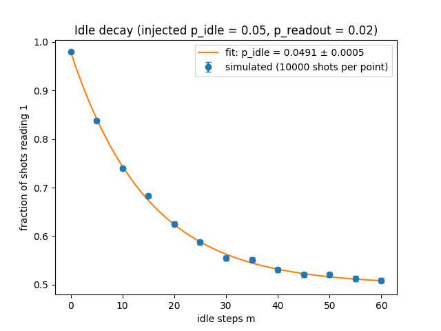
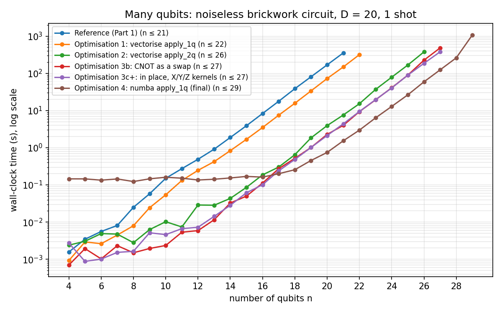

# Quantum circuit simulator: write-up
11/26/26
Sambid Wasti

The full version, with every round, measurement and derivation, is in
[WRITEUP_DETAILED.md](WRITEUP_DETAILED.md); the per-round record (commits, logs, profiles) is in
[results/progress.md](results/progress.md). Build and reproduction steps are in the [README](README.md).

**Approach.** Build the simplest simulator I could trust, pin it down with tests, validate the
noise end to end, then make it fast in measured steps: profile, change one thing, check against
the reference, benchmark, and keep or revert, recording every step.

## Part 1: a correct simulator

- **Clarity first.** Gates are matrices applied by two plain loops, `apply_1q` and `apply_2q`.
  Slow, but easy to check against the definitions, so it became the reference for Part 3
  (`sim_reference.py`, git tag `v1-reference`).
- **Parsing separate from simulation.** `read_circuit.py` turns the file into time steps;
  `sim.py` runs them. Invalid circuits (two gates on one qubit in a step) are rejected.
- **Tests:** each gate against its matrix (`test_gates.py`); noise limits, e.g. no noise gives
  ideal GHZ counts and readout alone flips with probability p_readout (`test_noise.py`);
  invariants, e.g. normalisation and gate-then-inverse (`test_invariants.py`).

## Part 2: validating the noise

X on one qubit, m idle steps (p_gate = 0), then measure; m = 0…60, 10,000 shots per point.
Per idle step the bit flips with probability q = ⅔·p_idle (X and Y flip it, Z does not), which
shrinks the distance d = f − ½ by (1 − 2q); readout scales it by (1 − 2r). So

  f(m) = ½ + ½ · (1 − 2r) · (1 − 2q)^m

Readout sets the height of the curve, p_idle the speed of its decay, so with p_readout known
(an input) the fit has one free parameter. Weighted fit (`curve_fit`, binomial error bars
√(f(1 − f)/N)): **p_idle = 0.04911 ± 0.00054** against 0.05 injected (1.66σ).

10,000 shots give error bars ≤ 0.005, small against the decay, and a 1% fit uncertainty. The
estimate stops being informative for very small p_idle (the decay is hidden under the error
bars), very large p_idle (it reaches ½ within a few steps) and large readout error (the whole
signal shrinks towards ½).

## Part 3: making it fast

**Setup.** Apple M3 Pro, 11 cores, 16 MiB L2, 18 GB memory, 150 GB/s published peak
(`hardware.md`). Benchmark: brickwork circuit, D = 20 (`brickwork.py`). Two regimes, each run in
a fresh process (`benchmark.py`): many qubits (noiseless, 1 shot, n from 4) and many shots
(n = 12, p_gate = p_idle = 10⁻³, p_readout = 10⁻², 10⁵ shots).

**Rounds.** Each started from the profile and was checked against the reference before
benchmarking.

| Round | Bottleneck → change | n = 19 | Shots/s | Result |
|---|---|---|---|---|
| Ref | Python loops over 2^n amplitudes | 81 s | 2.6 | baseline |
| 1 | `apply_1q` loop → NumPy on a reshaped view | 33.6 s | 6.1 | kept; `apply_2q` loop now 97% (Amdahl) |
| 2 | `apply_2q` loop → NumPy | 1.84 s | 109 | kept, 44× |
| 3a | ~8 NumPy calls per gate → one matmul | 2.25 s | 127 | **reverted:** many tiny 2 × 2^k blocks are slow |
| 3b | CNOT via 4×4 matrix → swap of two quarters | 0.944 s | 189 | kept |
| 3c | temporaries in `apply_1q` → in place | 0.891 s | 152 | kept for n ≥ 19 only: 21% slower on small states |
| 3c+ | X, Y, Z noise errors → swap / sign flip | 0.925 s | 192 | kept; no measurable change (rare errors) |
| 3d | RY in complex arithmetic → real arithmetic | 1.089 s | 169 | **reverted:** 3× fewer flops, but memory-bound |
| 4 | `apply_1q`: ~7 passes + call overhead → numba loop | **0.396 s** | **506** | kept: **205× (n = 19), 195× (shots)** |

**Correctness.** Every round passed `test_equivalence.py` (72 tests). Noiseless: final states
match the reference within 1e-12. Noisy: identical counts with the same seed, which only holds
while the random draws stay in the same order, so also a chi-squared test with different seeds
(20,000 shots each), which survives any reordering.

**Scaling.** Every gate touches the whole state, so time ≈ (gates) × 2^n: about 2.1× per qubit,
straight parallel lines on the log plot. Optimisations lower the line but cannot change the
slope. The final version reaches **n = 29** (peak memory 11 GB); n = 30 needs 16 GiB for the
state alone. Below n ≈ 16 its line is flat: about 0.14 s of loading numba is inside the timer.

**Bytes, flops and bandwidth.** RY moves 32N bytes and does 14N flops (N = 2^n); CNOT moves 24N
bytes and no flops. At about 0.4 flops per byte the kernels are memory-bound, which is why 3d
failed. Achieved bandwidth is **25–28 GB/s, 17–18% of the 150 GB/s peak**, steady for
n = 20–28. What stops it getting closer: one thread on one of 11 cores (the largest factor),
the access pattern for high qubits, and CNOT's temporary copy.

**Prediction.** time(n + 1) = time(n) × 2 × gates(n + 1)/gates(n) matches n = 22–28 within 8%.
For n = 29 it predicts **540 s**; measured **1080 s**. Memory capacity, not bandwidth, took over
(11 GB of 18 GB, compression and swapping). The n = 29 run predates the prediction, so it is
not a blind test.

**Limiting resource.** Many qubits: memory bandwidth, then memory capacity at n = 29. Many
shots: Python overhead, not hardware: the 64 KB state stays in cache, and the profile splits
the time between the numba loop (41%), CNOT (17%), rebuilding RY matrices every shot (14%) and
Python bookkeeping.

## What I would do next (Additional detail in [WRITEUP_DETAILED.md](WRITEUP_DETAILED.md))

1. **Multithreading** (numba `prange`): one core reaches only 17–18% of peak bandwidth.
2. **Reuse work across shots:** cache RY matrices (14%), CNOT in numba (17%), batch shots.
3. **Migrate to C++** and compare the benchmarks.
4. **More benchmark iterations:** repeats with error bars; single runs were ambiguous twice (3a, 3d).
5. **Wider testing:** equivalence tests at large n, and the Part 2 limit runs.
6. **Compare with Qiskit Aer**, and try a GPU version on the M3's unified memory.
7. **Test on a different machine** to check the results hold.
8. **Size-dependent kernels:** 3c showed the best method can change with n; find more crossovers.

## Resources used

- AI assistants Claude (Anthropic) and ChatGPT (OpenAI), used for various tasks.    
- J. Watrous,*Basics of Quantum Information* (IBM Quantum Learning).
- Nielsen and Chuang, *Quantum Computation and Quantum Information* (Cambridge, 2010), chapters 1 and 4; online references (e.g. Wikipedia).
